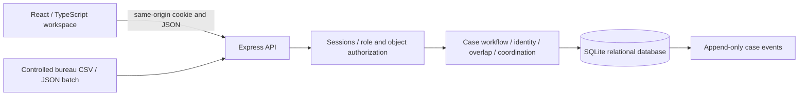

# Architecture and decisions

## Components

- Frontend: React, TypeScript, Lucide icons, custom responsive CSS, semantic forms/tables, modal keyboard trap, error boundary. No frontend case fixtures or static dashboard counts.
- API: Express 5, Zod validation, Helmet, JSON size limit. Sessions require same-origin cookies. Cross-origin mutations are rejected. Production session cookies require HTTPS.
- Domain: exact trusted permanent ID, verified alias/name plus region; unknown/conflicting identity queues. No fuzzy auto-merge. After identity verification, compare active cases within an institution and across bureaus. Rules identify issue candidates when category agrees and period/evidence/text overlaps; unrelated categories produce institution-level activity.
- Score: `100 × (0.45 × token Jaccard + 0.20 × same category + 0.20 × same period + 0.15 × shared evidence)`, rounded. Ranking score, not probability. Candidate classification uses explicit rules rather than a score threshold. No semantic model or accuracy claim.
- Database: SQLite through Node 24, foreign keys, indexes, WAL, transactional write service with savepoints, optimistic `version` checks, immutable event triggers.
- Source import: bounded 200-record atomic CSV/JSON batches with strict quoting validation and source/bureau checks. `(source,source_id)` uniqueness and skip-existing policy. No upstream update/overwrite. Case source and sync times remain distinct from local actions.
- Internal freshness: polling every 15 seconds and reload after mutations. Source age warnings after 24 hours. No push/SSE or external synchronization.
- Notifications: persisted for admin/owning bureau; overlap recipients must read both records. SLA reminders generated lazily on notification polling, deduplicated by case/deadline/state. No out-of-app delivery.

## Permissions

Admin reads all and writes all. Officer reads all nonrestricted cases and own bureau restricted cases, writes only own bureau. Viewer reads nonrestricted cases, cannot create/import/review/update. A review requires readable records and ownership of one participating case, or admin. Task completion requires the assigned officer or admin. Institution verification/policy changes require admin.

## Workflow

Pending → Under Process / Transferred / Escalated.
Under Process → Disposed / Transferred / Escalated.
Transferred → Under Process / Escalated.
Escalated → Under Process / Disposed / Transferred.
Disposed → Under Process (reopen with remarks).

Transfer changes bureau and checks officer membership; old bureau loses write access immediately. Every action records actor, original bureau, timestamp and remarks. Source case deletion is intentionally unsupported. Relationships remain as history when disposed/transferred pairs stop being active.

## Deployment boundary

One local Node process serves API and Vite in development or built static assets in production. Single-node SQLite suits a hackathon demonstration; bulk case lists aggregate in memory after scoped read and are paginated at response level. Before large-scale deployment, move filtering/aggregation/pagination into database queries, introduce PostgreSQL migrations and benchmark representative volumes. TLS, SSO, monitored backups, retention and authorized adapters are future pilot work. Docker configuration supplied but execution unverified.
